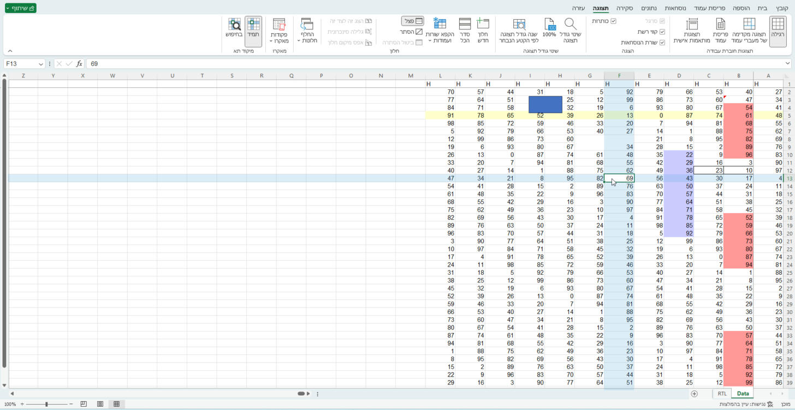
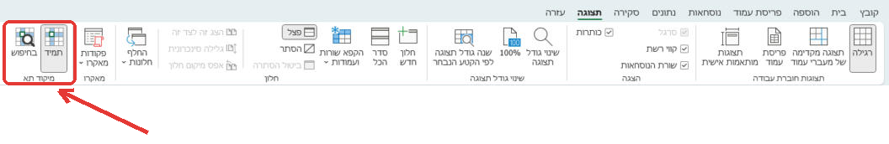
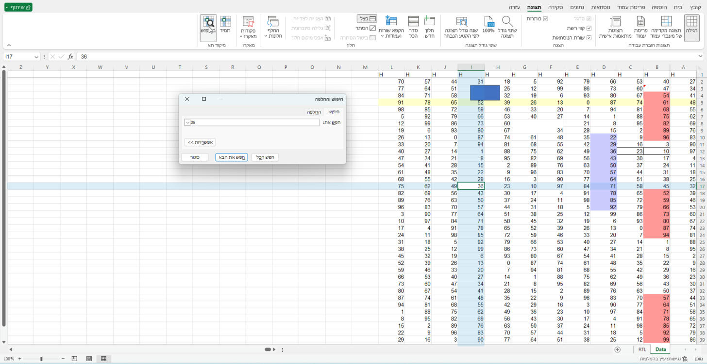

<div dir="rtl">

# מיקוד תא לאקסל (Excel Focus Cell)

**מדגיש את השורה והעמודה של התא הפעיל ב-Excel, בלי לגעת בקובץ.**

[English](README.md) · [עוד כלים חינמיים](https://natanor.co.il/free/)

## הורדה

**[להורדת הגרסה האחרונה](https://github.com/3en5/excel-focus-cell/releases/latest)** (`ExcelFocusCell-<גרסה>.zip`).
מחלצים את הקובץ, ומריצים ב-**Windows PowerShell** מתוך התיקייה שחולצה:

```powershell
powershell -ExecutionPolicy Bypass -File install\Install-User.ps1 -Dll .\Natanor.FocusOverlay.dll
```

פותחים את Excel מחדש, וההגדרות נמצאות בכרטיסייה **תצוגה**, בקבוצה **מיקוד תא**. אפשרויות נוספות בסעיף [התקנה](#התקנה).



רוב הכלים מהסוג הזה צובעים את התאים עצמם (מילוי או עיצוב מותנה) ומנסים לנקות אחר כך. כך נשארים צבעים בקבצים,
ה-Undo נשבר, והקובץ מסומן כאילו השתנה. **מיקוד תא מצייר שכבה שקופה מעל הגיליון.** שום דבר בקובץ לא משתנה: לא התאים,
לא העיצוב, לא היסטוריית ה-Undo ולא מצב "נשמר".

## מה יש בו

- **שני מצבים** בכרטיסייה **תצוגה**, בקבוצה **מיקוד תא**:
  - **תמיד**: השורה והעמודה של התא הפעיל מודגשות כל הזמן.
  - **בחיפוש**: מודגש רק כשחלון "חיפוש והחלפה" (Ctrl+F) פתוח, כך שכל "חפש את הבא" בולט מיד.
  - לחיצה נוספת על הכפתור הלחוץ מכבה. הבחירה נשמרת לכל משתמש.

  

- **גיליונות מימין לשמאל** נתמכים במלואם. נבדק עם הקפאת חלוניות ובלעדיה.
- הקפאה, פיצול חלון, תאים ממוזגים, זום, קנה מידה של 100%, 125% ו-150%, וכמה חוברות זו לצד זו.
- לחיצות עכבר עוברות דרך ההדגשה. חלונות ותפריטים של Excel נשארים מעליה.
- **מתג השבתה מרכזי למנהל** (ערך מדיניות אחד ברישום), שנכנס לתוקף בסשנים פתוחים תוך כ-5 שניות.
- **בנוי לשרתי טרמינל (RDS):** נבדק בסשני RDP כולל ניתוק וחיבור מחדש. כמעט אפס מעבד במנוחה.
- בלי גישה לרשת ובלי טלמטריה. הלוג המקומי רושם שינויי מצב ושגיאות בלבד, אף פעם לא ערכי תאים, נוסחאות או שמות קבצים.



## דרישות

- ‏Windows 10/11 או Windows Server 2016 ומעלה, עם **‎.NET Framework 4.8**.
- **Excel לשולחן העבודה ב-Windows.** נבדק על Office LTSC Professional Plus 2024 בגרסת 64 ביט (build 16.0.17932), בממשק עברית ובממשק אנגלית. גרסאות אחרות **עוד לא נבדקו**.

## התקנה

מחלצים את קובץ ה-zip מ[הגרסה האחרונה](https://github.com/3en5/excel-focus-cell/releases/latest), ומריצים ב-**Windows PowerShell** מתוך התיקייה:

```powershell
# רק למשתמש שלי (לא צריך הרשאות מנהל)
powershell -ExecutionPolicy Bypass -File install\Install-User.ps1 -Dll .\Natanor.FocusOverlay.dll

# לכל המשתמשים במחשב, למשל בשרת טרמינל (בהרשאות מנהל)
powershell -ExecutionPolicy Bypass -File install\Install-Machine.ps1 -Dll .\Natanor.FocusOverlay.dll
```

אחרי ההתקנה פותחים את Excel מחדש, וההגדרות נמצאות בכרטיסייה **תצוגה**, בקבוצה **מיקוד תא**.

> **הקובץ לא חתום דיגיטלית.** Windows עלול להזהיר על "מפרסם לא ידוע" בהורדה. סקריפטי ההתקנה מסירים את סימון ההורדה מהקובץ.
>
> Excel שרץ **בהרשאות מוגבהות**, למשל בחשבון ה-Administrator המובנה, מתעלם מרישום אישי. במקרה כזה משתמשים ב-`Install-Machine.ps1`.

## הסרה והשבתה מרכזית

```powershell
powershell -ExecutionPolicy Bypass -File install\Uninstall.ps1            # המשתמש הנוכחי
powershell -ExecutionPolicy Bypass -File install\Uninstall.ps1 -Machine   # כל המשתמשים (בהרשאות מנהל)
admin\Set-FocusOverlayPolicy.ps1 -Disable   # כיבוי לכולם במחשב
admin\Set-FocusOverlayPolicy.ps1 -Clear     # חזרה לבחירה של כל משתמש
```

## סטטוס

**בטא.** בשימוש יומיומי בשרת טרמינל Windows Server 2025 עם Office LTSC 2024.

## קרדיט

פותח על ידי **[KALIT](https://kalit.co.il)**, זרוע הפיתוח של **[נתן-אור שירותי IT לעסקים](https://natanor.co.il)**.

עוד כלים חינמיים: [natanor.co.il/free](https://natanor.co.il/free/).

ברישיון [MIT](LICENSE). רשימת השינויים ב-[CHANGELOG](CHANGELOG.md). לדיווח על בעיית אבטחה: [SECURITY.md](SECURITY.md).

</div>
