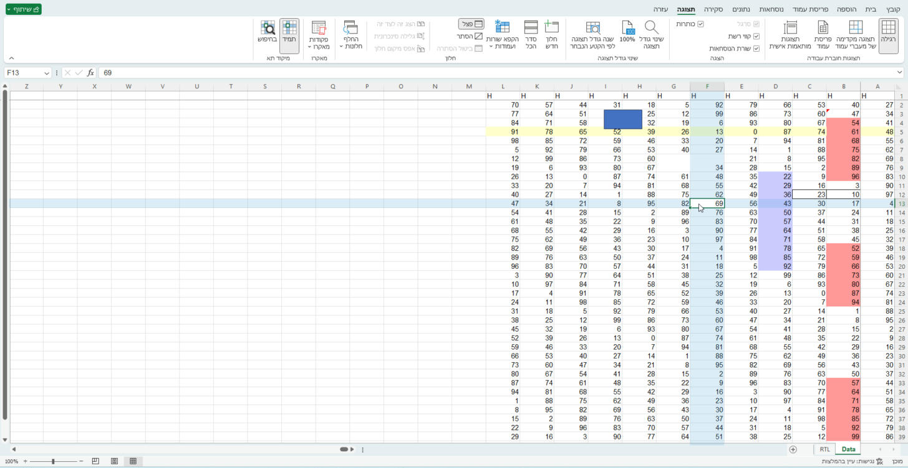
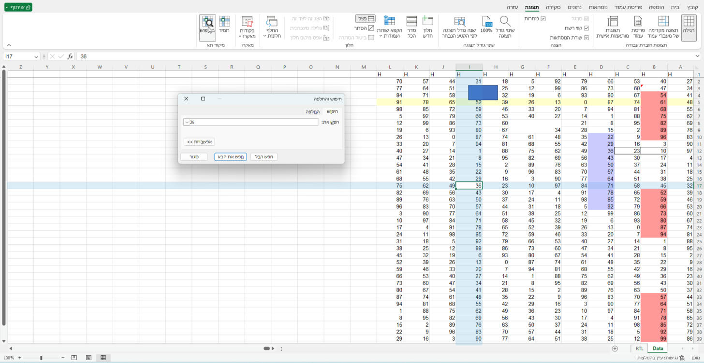

# Excel Focus Cell

**Highlights the row and column of the active cell in Microsoft Excel — without ever touching your workbook.**

[עברית](README.he.md)



Most "crosshair" tools for Excel colour the cells themselves (fills or conditional formatting) and try to clean up
afterwards. That can leave colours behind in your files, breaks Undo, and marks the workbook as changed.
**Excel Focus Cell draws a transparent layer *above* the grid instead.** Nothing in the workbook changes — not the
cells, not the formatting, not the Undo history, not the "saved" state.

## Features

- **Two modes** on the **View** tab, group **Focus**:
  - **Always** — the active row and column are highlighted all the time.
  - **On search** — highlighted only while *Find and Replace* (Ctrl+F) is open, so every *Find Next* is easy to spot.
  - Click the pressed button again to switch off. The choice is remembered per user.
- **Right-to-left sheets** (Hebrew, Arabic) are first-class: tested with and without frozen panes.
- Frozen panes, split windows, merged cells, zoom, 100% / 125% / 150% display scaling, several workbooks side by side.
- Mouse clicks pass straight through the highlight; Excel dialogs and menus stay on top of it.
- **Central off switch for administrators** (one registry policy value), applied to running sessions within ~5 s.
- Built for **terminal servers / RDS**: one instance per Excel process, tested inside RDP sessions including
  disconnect/reconnect, near-zero CPU when idle.
- No network access, no telemetry. A small local log (`%LOCALAPPDATA%\NatanorFocusOverlay\focus-overlay.log`)
  records state changes and errors only — never cell values, formulas or file names.



## Requirements

- Windows 10/11 or Windows Server 2016+ with **.NET Framework 4.8**
- **Excel for Windows** (desktop). Tested on **Office LTSC Professional Plus 2024, 64-bit, build 16.0.17932**, Hebrew
  and English UI. Other versions are expected to work but are **not tested yet** — reports welcome.
- Not for Excel for Mac or Excel on the web.

## Install

Download `Natanor.FocusOverlay.dll` and the `install` folder from the latest release (or build it — see below), then
in **Windows PowerShell**:

```powershell
# Just for me (no admin rights needed)
powershell -ExecutionPolicy Bypass -File install\Install-User.ps1 -Dll .\Natanor.FocusOverlay.dll

# For every user of this computer, e.g. a terminal server (run as administrator)
powershell -ExecutionPolicy Bypass -File install\Install-Machine.ps1 -Dll .\Natanor.FocusOverlay.dll
```

Restart Excel and look for **Focus** on the **View** tab.

> The DLL is **not code-signed**. Windows may warn about an unknown publisher when you download it; the install
> scripts unblock the copied file. Excel itself loads unsigned COM add-ins unless your organisation requires signed
> add-ins.
>
> An Excel that runs **elevated** (for example under the built-in Administrator account) ignores per-user COM
> registrations — use `Install-Machine.ps1` there.

### Uninstall

```powershell
powershell -ExecutionPolicy Bypass -File install\Uninstall.ps1            # current user
powershell -ExecutionPolicy Bypass -File install\Uninstall.ps1 -Machine   # all users (as administrator)
```

### Administrators: central switch

```powershell
admin\Set-FocusOverlayPolicy.ps1 -Disable   # off for everyone on this machine; the buttons turn grey
admin\Set-FocusOverlayPolicy.ps1 -Clear     # back to each user's own choice
```

It writes `HKLM\SOFTWARE\Policies\Natanor\FocusOverlay\Enabled` (DWORD, `0` = off). The same value under
`HKCU\SOFTWARE\Policies\...` disables it for one user (e.g. via Group Policy).

## Build from source

No Visual Studio or SDK needed — the C# compiler that ships with .NET Framework is enough:

```powershell
powershell -ExecutionPolicy Bypass -File build.ps1
```

It needs the Office interop assemblies (`Microsoft.Office.Interop.Excel` and `office.dll`, version 15) from the GAC,
or pass `-InteropDir <folder>`. The output is `bin\Natanor.FocusOverlay.dll`.

## How it works

A plain COM add-in (no VSTO). It reads only positions from Excel's object model — the active cell, merged area,
each pane's visible range and Excel's own points-to-pixels conversion — never cell values, and never calls any
setter, `Select` or `Activate`. A single per-pixel-alpha layered window, owned by the workbook window and placed just
above it, is drawn with `UpdateLayeredWindow`. It is click-through (`WS_EX_TRANSPARENT`) and never takes focus.

Performance notes that shaped the design (measured):

- Object-model calls are not free inside Excel; some cost far more than others (`Range.MergeCells` took ~5.8 ms per
  call, `MergeArea.Count` ~18 µs). The add-in makes **no** object-model calls while you are not typing or clicking.
- Pane geometry and row/column sizes are cached and re-validated once a second, so a selection move costs a handful
  of fast calls.
- In right-to-left sheets Excel's `PointsToScreenPixelsX` answers as if the sheet were left-to-right; the add-in
  mirrors the result around the grid window.

## Status

**Beta.** In daily use on a Windows Server 2025 terminal server with Office LTSC 2024. Not yet tested: other Excel
versions, multiple monitors with different scaling, 200% scaling, Protected View.

## Credits

Developed by **[KALIT](https://kalit.co.il)** — the development arm of **[Natanor IT Services](https://natanor.co.il)**.

Licensed under the [MIT License](LICENSE).
